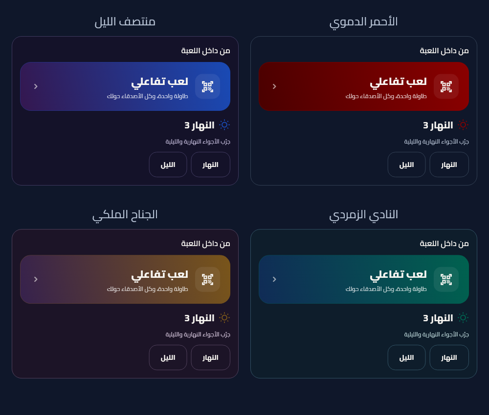

 

### مدينة واحدة. أسرار كثيرة. حكم واحد.

إدارة سينمائية للمافيا الكلاسيكية، مع لعب تفاعلي مباشر عبر QR.

 

&nbsp;

  

 

## عن اللعبة

**مافيا عالشوارب** هو رفيق الحكم لإدارة جلسة مافيا وجهًا لوجه. يوزّع الأدوار، يقود إيقاع الليل والنهار، ويمنح كل لاعب تجربة خاصة من هاتفه عبر المتصفح — بمجرد مسح رمز QR، من دون تنزيل تطبيق للاعبين.

الحكم يبقى ممسكًا بإيقاع المدينة؛ واللاعبون يخفون أسرارهم، ينفّذون قدراتهم، ويصوّتون من أجهزتهم.

## طريقة اللعب

| ١ — جهّز الجلسة | ٢ — امسح الرمز | ٣ — العب دورك | ٤ — اكشف الحقيقة |
| :---: | :---: | :---: | :---: |
| الحكم يضيف ٤ لاعبين أو أكثر، يراجع الأدوار ويعيد توزيعها إذا أراد. | كل لاعب يختار مقعده من صفحة الويب؛ اسم المقعد هو اسمه داخل اللعبة. | تصويت، اغتيال، حماية، تحقيق وقدرات الأدوار — من هاتف اللاعب. | الحكم يدير الدفاع والحسم، ثم تظهر نتيجة الجولة وتُسجّل في صحيفة المدينة والإحصائيات. |

## ليلةٌ لها أسرار، ونهارٌ له كلمة

<table dir="rtl">
  <tr>
    <td width="50%" valign="top">
      <h3>🌙 في الليل</h3>
      
تعمل قدرات الأدوار سرًا: المافيا تختار هدفها، بنت المواطنين تحمي لاعبًا، وشيخ المواطنين يحقق في هوية لاعب. تصل الأفعال للحكم وتُحسم ضمن تسلسل اللعبة.

    </td>
    <td width="50%" valign="top">
      <h3>☀️ في النهار</h3>
      
يناقش اللاعبون ما جرى، ثم يصوّتون. يحصل اللاعب المرشّح على وقت للدفاع، ويستطيع الحكم تأكيد القرار أو تغيير التصويت وإدارته قبل الحسم.

    </td>
  </tr>
  <tr>
    <td width="50%" valign="top">
      <h3>🎭 كشف سينمائي</h3>
      
تظهر الأدوار في لحظات الكشف والإقصاء، مع مؤثرات صوتية وبطاقات درامية تحفظ توتر اللعبة حتى آخر جولة.

    </td>
    <td width="50%" valign="top">
      <h3>📰 صحيفة المدينة</h3>
      
تسلسل للأحداث والإقصاءات، مع إحصائيات اللاعبين ونتيجة المباراة للرجوع إليها بعد انتهاء اللعب.

    </td>
  </tr>
</table>

## أجواء تختارها لليلتك

الأحمر الدموي المجاني يحافظ على الهوية الأصلية؛ الثيمات المدفوعة تمزج لونين بتدرجات غنية مع بقاء ألوان أدوار الفرق واضحة. يمكن معاينتها من الإعدادات قبل الاشتراك.

## أدوار المدينة

| الفريق | الأدوار |
| :--- | :--- |
| 🔴 **المافيا** | شيخ المافيا، بنت المافيا، ومافيا عادي |
| 🔵 **المواطنون** | شيخ المواطنين، بنت المواطنين، المواطن الشجاع، ومواطن صالح |
| 🟣 **مستقل** | الجوكر |

## إصدار Android 1.2.2

[**تحميل APK — ARM64، إصدار 1.2.2، Build 9**](https://github.com/HamzaSEBE/MafiaGame/raw/main/releases/mafia-nightfall-1.2.2-arm64.apk)

نسخة release للاختبار على هاتف Android فعلي، بحجم نحو 37 MB، وتتطلب Android 7.0 أو أحدث. تحمل نفس توقيع APK السابق، ورقم إصدار Android هو 2009.

الأحمر الدموي الأصلي على تسجيل الدخول والافتتاحية أيضاً، وثيمات Premium بمزيج لونين: أزرق وبنفسجي، زمردي وأزرق، وذهبي وبنفسجي. الفوز التقليدي يقارن المافيا والمواطنين الأحياء دون الجوكر؛ عند التعادل فقط تُمنح فرصة إذا اجتمع قنص مواطن غير مستخدم مع حماية متاحة لبنت المواطنين. زر Upgrade to Premium يفتح Pricing، والثيمات في الإعدادات. المساعد الصوتي ميزة Premium قادمة وغير مفعّلة؛ الدفع الحقيقي لم يُربط بعد.

**التحقق:** نجحت 91 تجربة Flutter و21 اختبار قواعد و7 اختبارات خادم، والتحليل الساكن بلا مشاكل. نسخة الويب محدثة، وقواعد QR والفهارس المنشورة في 1.2.1 باقية. خادم V2 والخدمات المدفوعة معطلة افتراضياً؛ لم يُجرَ اختبار 100 ألف مستخدم.

[بيانات APK والتوقيع وSHA-256](releases/apk-info-1.2.2.json)

## التحميل واللعب

1. نزّل وثبّت **تطبيق الحكم** على هاتف Android.
2. ابدأ جلسة جديدة، أضف خمسة لاعبين على الأقل، ووزّع الأدوار.
3. اعرض رمز QR ليختار كل لاعب مقعده من هاتفه.
4. أدر اللعبة من شاشة الحكم، واترك للاعبين تنفيذ أدوارهم من المتصفح.

اللعب الكلاسيكي وإدارة الحكم متاحان دون إنترنت. **اللعب عبر QR يحتاج اتصالًا بالإنترنت** لمزامنة الجلسة بين أجهزة اللاعبين.

## التقنيات

`Flutter` · `Dart` · `Firebase Authentication` · `Cloud Firestore` · `Firebase Hosting`

 

[المستودع على GitHub](https://github.com/HamzaSEBE/MafiaGame) · [افتح نسخة الويب](https://mafiagame-351f8.web.app) · [حمّل APK](https://github.com/HamzaSEBE/MafiaGame/raw/main/releases/mafia-nightfall-1.2.2-arm64.apk)

صُنعت لعشّاق المؤامرات… وللحكم الذي لا يفوته شيء.

