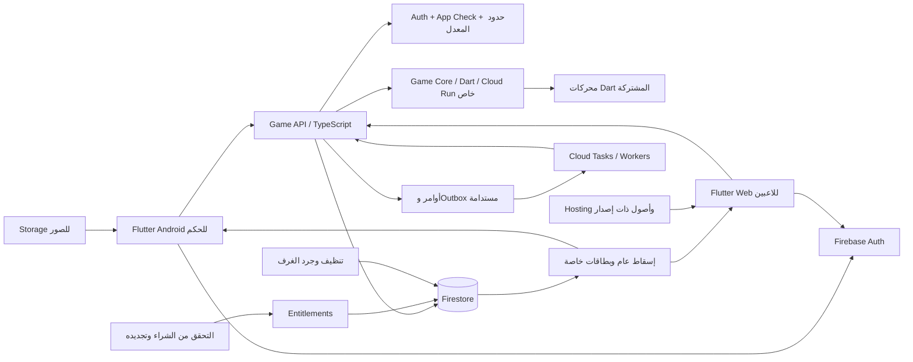
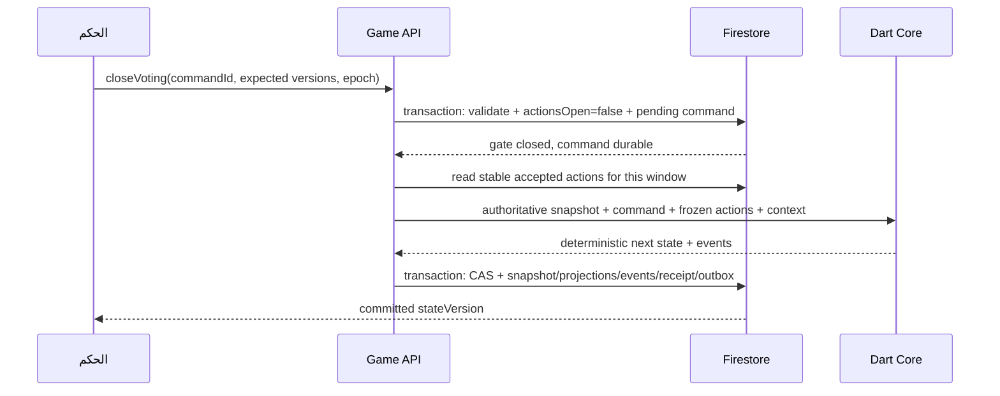

# Architecture التنفيذ: تطبيق قابل للتوسّع إلى 100 ألف مستخدم متزامن

التاريخ: 10 أكتوبر 2026. الحالة: **تصميم مستهدف وخطة تحقق، وليس شهادة سعة حالية**.

اقرأ أولاً [البنية الحالية](architecture.md) و[دليل تشغيل V2](server-v2-runbook.md). كل الأرقام أدناه افتراضات هندسية أو أهداف قبول، ما لم يُذكر أنها نتائج قياس.

## 1. قرارات أساسية

1. نحتفظ بـFlutter وRiverpod وFirebase Auth وFirestore وHosting. لا توجد نتيجة قياس تبرر استبدال قاعدة البيانات أو إنشاء شبكة WebSocket خاصة الآن.
2. التطبيق **modular**: domain خالص، controllers/use cases في application، adapters في data، وWidgets تعرض الحالة وترسل intent.
3. المسار المحلي يشغّل محرك Dart ويحتفظ بحالة محلية. المسار التفاعلي يقرأ إسقاطات Firestore ويُرسل الأوامر لخدمة موثوقة؛ جهاز الحكم لا يكون مصدر الحقيقة الوحيد.
4. يستهدف الحمل غرفاً صغيرة موزعة. افتراض التخطيط 20 لاعباً + حكم لكل غرفة، مع اختبار أحجام 4/10/20/40. حد 200 الموجود لا يُعتمد كحجم غرفة مدعوم قبل اختبار مستقل.
5. نحافظ على identifiers الموجودة للثيمات والقواعد والبيانات. لا تعيد كتابة اللعبة والتصميم والدفع والترحيل دفعة واحدة.
6. المتطلبات المجانية الأساسية، الخصوصية، استعادة الجلسة، واستقرار الشبكة ليست ميزات مدفوعة. Premium يتحكم بالتخصيص والقيمة الإضافية فقط.

هذا الفصل بين مسؤولية العرض والحالة والمستودعات يتوافق مع [دليل بنية Flutter](https://docs.flutter.dev/app-architecture/guide). توزيع الحمل على الغرف قرار مستنتج من طبيعة هذا التطبيق، وليس ضماناً خاصاً من مزود الخدمة.

## 2. مخطط النظام المستهدف



### لماذا وحدتا backend؟

- **Game API TypeScript** تستخدم Firebase Admin SDK الرسمي للتحقق من الهوية وApp Check، ومعاملات Firestore والشراء والمهام. تضم وحدات game/account/billing/lifecycle في codebase واحد، وليست عشر خدمات منفصلة.
- **Game Core Dart** خدمة داخلية stateless تشغّل محركات المشروع الحالية عند انتقالات الحكم. لا تفتح مستمعين ولا تحتاج قاعدة بيانات ولا تستقبل طلبات المستخدم مباشرة. الوصول لها بـCloud Run IAM ومن حساب خدمة الـAPI فقط.
- حركات اللاعبين العادية تُتحقق من عضويتهم والأهداف التي أصدرها الخادم، وتُحفظ من الـAPI دون RPC للمحرك في كل نقرة. انتقالات الليل/الحسم والتوزيع تستعمل المحرك المشترك.
- تبقى القواعد في Dart بدلاً من إعادة تنفيذها في TypeScript والتسبب في اختلاف حساب النتائج. كلفة RPC تُقاس في prototype قبل تثبيت إعداد السعة. لو ثبت أنها عائق، يتغير adapter المحرك مع بقاء العقود؛ لا نعتمد مكتبة Admin Dart غير متحقق منها للتخلص من حد نشر واحد.

Cloud Run يشغّل الحاوية وفق [عقد التشغيل](https://docs.cloud.google.com/run/docs/container-contract). ضبط autoscaling يحتاج قياساً، وحدود instances والـconcurrency لا تعني سعة مضمونة. [توثيق autoscaling](https://docs.cloud.google.com/run/docs/about-instance-autoscaling).

## 3. حدود المسؤولية والاعتماد

| الطبقة | يُسمح لها | لا يُسمح لها |
|---|---|---|
| Domain / Game Core | كيانات وقواعد وحساب وانتقالات وأخطاء typed | Widgets، Firebase، Riverpod، network، قراءة الساعة مباشرة أثناء reducer |
| Application | use cases، controllers، lifecycle، تنسيق عمليات عبر interfaces | إدارة JSON الخام في Widgets أو منح Premium من العميل |
| Data | HTTP، Firestore DTOs، معاملات، caching، تخزين محلي | تقرير فوز أو سياسة أدوار مستقلة عن domain |
| Presentation | العرض، accessibility، التنقل، إرسال intent | حساب التصويت/الفوز، حذف طلبات للانتقال، التحدث مع Firebase مباشرة |
| Game API | authorization، idempotency، validation، persistence، projections | الثقة بحالة كاملة أو winner أو role مرسل من العميل |
| Game Core service | `TransitionInput -> TransitionResult` ثابت وقابل للاختبار | توليد نتيجة مختلفة عند تكرار الأمر نفسه أو كتابة خارج المعاملة |

تعريف interfaces المستودعات التي تحتاجها use cases يكون في طبقة لا تعتمد على Firebase. الـproviders تركّب implementations عند bootstrap. استخدم providers scoped بالحساب والغرفة وألغِ اشتراكاتها عند الخروج؛ لا تفتح مستمعاً مستقلاً لكل Widget.

## 4. تنظيم الملفات تدريجياً

لا تنقل كل شاشة لمجرد تغيير المجلد. أدخل العقود والـcontrollers أولاً، ثم انقل الملفات مع تحديث imports واختبارات في كل مرحلة.

```text
lib/
  app/
    bootstrap.dart
    environment.dart
    routing/
  domain/
    game/                  # interfaces وأنواع التطبيق التي ليست ضمن package
    premium/               # FeatureKey, Entitlement, AccessDecision
    account/
    repositories/          # عقود مجردة؛ لا Firebase types
  application/
    game/                  # local_game_controller, setup_controller
    interactive/           # host_session_controller, player_session_controller
    account/
    premium/
    themes/
  data/
    remote/                # game_api_client, firestore projections, DTOs
    local/                 # checkpoints, preferences, bounded verified cache
    repositories/
    billing/
  presentation/
    home/ auth/ setup/ day/ night/ voting/ interactive/
    premium/ themes/ account/ history/ stats/
    design_system/         # tokens، مكونات مشتركة، ThemeExtension
packages/
  game_core/
    lib/src/{entities,rules,commands,events,engine}/
    test/                  # القواعد المرجعية للمسارين والخدمة
server/
  api/                     # TypeScript، Firebase Admin، HTTP/use cases/workers
    src/{auth,game,account,billing,lifecycle,observability}/
  game_core_service/       # Dart، adapter HTTP خاص، يعتمد على game_core
contracts/
  game-api.openapi.yaml
  fixtures/                # مدخلات/مخرجات مرجعية مشتركة بين TS/Dart
infra/
  environments/
  firestore/               # قواعد وفهارس وTTL ومخططات الترحيل
  monitoring/
tool/
  load/                    # runners ومخطط workload وتوليد بيانات staging
  legacy/                  # محفوظ؛ لا تستخدمه للتعديل
test/
  application/ presentation/ integration/ security/
```

في البداية يمكن إبقاء المسارات الحالية وإضافة `application/interactive/...` و`presentation/theme/app_theme_extensions.dart`. استخراج `game_core` خطوة محددة لاحقاً؛ لا تجعل عرض Premium يعتمد على ترحيل كل الملفات.

## 5. محرك واحد للمحلي والتفاعلي

العقد المقترح:

```dart
TransitionResult reduceGame(
  GameSnapshot snapshot,
  GameCommand command,
  CommandContext context,
);

// context: commandId, occurredAt, randomSeed, rulesVersion
// result: nextSnapshot, domainEvents, effectDescriptors
```

- `occurredAt` وseed يُولدان مرة واحدة عند قبول الأمر ويُحفظان معه؛ إعادة المحاولة لا تغيّرهما. الفحص الحاسم لا يعتمد على وقت هاتف المستخدم.
- event IDs تُشتق من commandId ونوع الحدث؛ حذف/إعادة إرسال callback لا يعيد الإقصاء أو استهلاك القدرة.
- كل أمر له allowed phases صريحة. الـUI guards مساعدة، وليست validation النهائي.
- `GameState` snapshot immutable؛ قوائمه وmetadata محمية من التعديل. مساواة snapshot تعتمد قيمته أو إصداره، وليست معرّف المباراة فقط.
- `copyWith` يدعم مسح nullable fields صراحة عند الحاجة، دون الاعتماد على `null ?? oldValue` لمسح winner أو نتيجة.
- خطوات الليل المحلية وprompts التفاعلية مشتقة من `ActionEligibility` واحدة. تبقى نصوص العرض خارج domain.
- ثبّت القواعد الحالية باختبارات: ليلة التعارف، أدوار مكررة، هدف اغتيال واحد وفق ترتيب قيادة المافيا، حماية وتصميت بحد -1، القناص والتخطي، صوت الشيخ ×3، التعادل وإعادة التصويت، الانتقام قبل الفوز، الجوكر، exact executions.
- عند وجود غموض في قاعدة لعبة، احتفظ بالسلوك المرجعي الحالي ودوّن القرار. تحسين Architecture لا يغيّر التوازن من تلقاء نفسه.

## 6. نموذج Firestore الجديد

استخدم namespace جديداً **`sessionsV2`**. الجلسات القديمة تظل على عقدها القديم حتى تنتهي. أسماء المسارات هنا عقد مستهدف، وليست موجودة حالياً.

```text
sessionsV2/{roomId}
  schemaVersion, protocolVersion, rulesVersion
  hostUid, status, phase, round, winner
  stateVersion, actionRevision, actionsOpen
  processing, pendingCommandId, controlVersion
  themePackId, themePackVersion
  createdAt, updatedAt, expiresAt
  roster[]                 # إسقاط صغير: seatId/name/alive/reveal فقط
  private/state            # الحالة المعتمدة والأدوار والقواعد والعدادات
  private/hostControl      # lease/hostEpoch/deviceSessionId؛ لا يقرأه اللاعب
  members/{uid}            # seatId + timestamps؛ قراءة الذات أو الحكم
  seats/{seatId}           # بيانات العضوية؛ ليست قائمة broadcast للاعبين
  secrets/{seatId}         # role, promptRevision, prompts, privateResults
  joinRequests/{uid}
  actionWindows/{revision}
    actions/{uid_actionType}  # action, ballotVersion, receivedAt
    receipts/{requestId}      # uid + payloadHash + نتيجة قبول الطلب
  commands/{commandId}     # intent/state/status/seed/time/result reference
  events/{eventId}          # append-only؛ لا يقرأ اللاعب الأسرار منه
  outbox/{jobId}            # مهام انتقال/نتائج/تنظيف قابلة لإعادة التشغيل

users/{uid}                # profile صغير
  settings/appearance      # preferredThemeId + version
  settings/roleNames
  entitlements/current     # server-managed
  playerProfiles/{id}      # هوية مستقرة؛ الاسم قابل للتعديل
  games/{gameId}           # ملخص صغير لسجل المباراة
  stats/{playerProfileId}
  gameResults/{gameId}     # marker منع التكرار؛ يحافظ على سلوك الحذف السابق

billingPurchases/{provider_tokenHash}   # لا يقرأها العميل
billingEvents/{eventId}                 # dedup وstatus؛ لا بيانات دفع في logs
```

### الأحجام والإسقاطات

- room public projection يتضمن roster صغيراً للغرفة لتقليل قراءات بداية الاتصال. لا roles مخفية أو UID أعضاء أو أصوات سرية فيه.
- هدف أولي لحجم room projection أقل من 16 KiB، وprivate snapshot أقل من 256 KiB؛ هذه حدود التطبيق المقترحة، لا حدود المزود. عند تجاوزها تُقسّم البيانات أو تُرفض حمولة الإعداد بخطأ واضح.
- لا تحشر history غير المحدود داخل snapshot. احتفظ بعدادات قدرات وحالة لازمة للحساب، وأحداث مستقلة مع sequence. summary النهائي صغير، وتفاصيل التقرير لها صفحات أو ملف Storage خاص عند الحاجة.
- لا صور Base64 في profile أو entitlements. صورة avatar مصغرة ذات version ومصدر واحد، وتحميلها مستقل.
- اختيار roster واحد مناسب لغرف 20–40 وتغييرات قليلة؛ تغيير كل حركة فيه ممنوع. الغرف الأكبر تحتاج قياس fan-out مستقل وربما نموذج roster مختلف.

Firestore يحدد حجم المستند والطلب وعدد قراءات قواعد الأمان. لا تختَر حجم غرفة فقط من عدد كتابات الدفعة. اختبر حدود البيانات والقواعد والفهارس على العقد الفعلي. [الحدود الرسمية](https://firebase.google.com/docs/firestore/quotas).

## 7. البروتوكول ومنع التضارب

### أرقام الإصدارات

| الحقل | المعنى |
|---|---|
| `protocolVersion` | عقد الحكم واللاعب والـAPI المتوافق |
| `schemaVersion` | صيغة التخزين وDTO migration |
| `rulesVersion` | نسخة قواعد اللعبة؛ تثبت داخل المباراة |
| `stateVersion` | آخر حالة لعبة معتمدة؛ يزداد عند انتقال أو تغيير دلالي |
| `controlVersion` | تغييرات gate/processing/lease؛ لا تساوي جولة اللعبة |
| `actionRevision` | نافذة حركات محددة؛ تزيد عند فتح نافذة جديدة أو revote |
| `promptRevision` | إصدار الأهداف المسموحة في البطاقة؛ يجب أن يساوي actionRevision |
| `ballotVersion` | نسخة الصوت الحالي للاعب؛ تمنع إعادة طلب قديم فوق اختيار أحدث |
| `hostEpoch` | fencing token لجهاز الحكم صاحب التحكم |

الإفصاح عن الشيخ أثناء التصويت يغير الحالة والإسقاط العام، ويحافظ على نافذة التصويت والأصوات إذا بقيت صلاحية التصويت كما هي. لا تزيد actionRevision لكل تحديث زخرفي أو private result.

### طلب لاعب

```json
{
  "protocolVersion": 2,
  "requestId": "random-request-id",
  "roomId": "random-room-id",
  "seatId": "seat-id",
  "expectedActionRevision": 7,
  "expectedBallotVersion": 2,
  "actionType": "vote",
  "targetId": "target-seat-id"
}
```

`uid` يُستخرج من التوكن، و`expectedBallotVersion` مطلوب لتغيير الصوت فقط. لا تطلب stateVersion مطابقاً لكل فعل لاعب إذا حدث تحديث غير متعلق بصلاحية النافذة؛ التحقق يكون من النافذة والأهداف والعضوية والحياة ذات الصلة.

### طلب حكم

```json
{
  "protocolVersion": 2,
  "commandId": "random-command-id",
  "roomId": "random-room-id",
  "expectedStateVersion": 12,
  "expectedActionRevision": 7,
  "hostEpoch": 3,
  "type": "closeVoting"
}
```

العميل يرسل intent ومعطيات محدودة مثل خيارات الإعداد. لا يرسل winner أو state كامل للاعتماد، ولا يمسح طلبات اللاعبين. لكل نوع أمر schema بحد طول وحجم وعدد عناصر.

### تنفيذ حركة اللاعب

1. الـAPI يتحقق من Firebase ID token وApp Check وحد المعدل وحجم الطلب والبروتوكول.
2. معاملة تقرأ room gate والعضوية والبطاقة والأمر السابق وreceipt. تحقق `actionsOpen`، revision، ملكية المقعد، الدور والهدف والحدود.
3. إذا receipt موجود ومطابق لـuid/hash أعد النتيجة السابقة؛ إذا requestId مع حمولة مختلفة ارفضه.
4. الحركة الليلية غير قابلة لتغيير الهدف داخل النافذة. إعادة طلب مطابق تعيد القبول السابق. تغيير الصوت يتطلب ballotVersion ويزيده؛ الطلب المتأخر لا يكتب فوق اختيار أحدث.
5. اكتب action وreceipt فقط. لا تكتب counter عالمي أو room doc لكل صوت. أعد `accepted/revision/ballotVersion/serverTime`.
6. المستمع يعرض قبول الحركة. خطأ الشبكة أو timeout لا يعني رفضها؛ أعد الاستعلام أو الطلب **بالمعرّف والحمولة نفسيهما**.

قراءة الـAPI للغرفة داخل المعاملة قد تسبب contention مع انتقال أو عند كثافة الغرفة حسب نمط المعاملات. اختبره فعلياً؛ عدم كتابة عداد غرفة لكل صوت يقلل التضارب لكنه لا يلغيه.

### إغلاق نافذة وحسمها دون فقد الأفعال



- أي action transaction تقرأ gate القديم وتتزامن مع إغلاقه إما تُعتمد قبل الإغلاق، أو تتعارض وتُعاد فترفضها النافذة المغلقة. لا يُعتمد فعل بعد الإغلاق، ولا نأخذ snapshot UI cached كقائمة الأصوات الحاسمة.
- نافذة مغلقة تجعل query الأفعال ثابتة. لا تحذفها أثناء الحسم. احفظ digest المدخلات في command للتدقيق.
- command يصبح مستداماً في معاملة إغلاق gate. outbox dispatcher وsweeper يستدعيان إكماله عبر مهام مستقلة؛ فقد الاستجابة أو موت instance لا يترك اللعبة بلا طريقة إكمال.
- commit النهائي يفحص stateVersion/pendingCommandId وfencing للـworker، ويكتب الحالة الخاصة والإسقاطات والـevents ونتيجة الأمر. pending transition يمنع أمر حكم متعارضاً.
- worker يحصل في معاملة على lease للأمر مع `workerEpoch` متزايد ومدة محدودة؛ انتهاء lease يسمح لworker آخر بإكماله. commit يطابق epoch، فيرفض worker قديماً عاد بعد انقطاع. صلاحية الحكم تُفحص عند قبول intent؛ انتهاء lease جهازه لاحقاً لا يلغي أمراً معتمداً قيد الإكمال.
- أثناء processing تُعرض آخر حالة معتمدة ويُعطّل إرسال فعل جديد برسالة قصيرة. الفشل القابل للإعادة يُستأنف؛ الفشل الدائم يظهر للحكم مع errorId ولا يعيد فتح النافذة آلياً بإصدار قديم.
- مقاطعة مهام متكررة لا تعيد الاغتيال/الانتقام/الإحصائيات. queue delivery ليست exactly-once؛ التصميم يعتمد على idempotency.
- أوامر مثل `reveal` و`publishInvestigationResult` لها handlers موثوقة؛ النتيجة الخاصة مرتبطة بـrevision ولا تُكتب فوق بطاقة مرحلة أحدث. معرفة الدور لا تُحسب في كود واجهة الحكم.

Firebase يحذر من افتراض ترتيب أو تنفيذ وحيد للـtriggers؛ handlers تحتاج منع التكرار. [توثيق Firestore triggers](https://firebase.google.com/docs/functions/firestore-events).

### الأخطاء والعرض

عقد ثابت: `UNAUTHENTICATED`, `ROOM_ENDED`, `STALE_WINDOW`, `STATE_CONFLICT`, `HOST_LEASE_LOST`, `INVALID_TARGET`, `ALREADY_SUBMITTED`, `RATE_LIMITED`, `UNAVAILABLE`, `PAYMENT_PENDING`. كل استجابة تحمل request/trace ID، والحالات retryable لها إشارة وRetry-After مناسب.

تترجم الواجهة الأخطاء إلى عربية واضحة. لا تعرض تعليمات نشر القواعد أو تفعيل Anonymous Auth للاعب النهائي؛ هذه تشخيصات للمراقبة. التوكنات والأدوار والطلب الخام لا تُسجّل في logs.

## 8. الاسترجاع وoffline

### المحلي

- `LocalGameRepository` يحفظ snapshot وschema/rules version محلياً بعد كل أمر ناجح، مع كتابة ذرية ونسخة أخيرة سليمة.
- فتح التطبيق يعرض «متابعة الجلسة» عند وجود checkpoint؛ replay لا يعيد الأصوات والمؤثرات التي سبق عرضها.
- لا يعتمد اللعب المحلي الأساسي على قراءة Firebase عند بدء كل لعبة. عند وجود حساب سابق تبقى التفضيلات المحفوظة محلياً قابلة للاستعمال، مع حدود صلاحية Premium الموضحة في وثيقة التصميم.
- استخدام محلي بلا حساب قرار منتج مستقل؛ لا تغيّر متطلبات التسجيل القائمة دون تثبيت ذلك صراحة.

### التفاعلي

- مصدر الحقيقة checkpoint الخادمي، وليس ذاكرة Riverpod أو current route.
- حساب الحكم لديه index خاص للغرف القابلة للاستئناف، وليس list عاماً لـsessions.
- lease مربوط بـdevice session ووقت خادمي: تجديد كل 60 ثانية ومدة أولية 180 ثانية، قابلة للتعديل بالقياس. device جديد يستلم بعد انتهاء lease أو takeover صريح، ويزيد hostEpoch. الجهاز السابق يفقد حق إرسال أوامر فوراً.
- فقد شاشة الحكم لا يلغي أصوات مقبولة. غرفة ذات حكم غير متصل تبقى بحالتها حتى انتهاء السياسة أو استئنافها، مع message مناسبة للاعبين.
- cache يسمح بعرض آخر معلومات، لكن transaction/API offline لا يُعرض نجاحاً. لا تعِد إرسال فعل من نافذة انتهت عند عودة الاتصال.
- استعادة العضوية بالـUID نفسه، مع عدم ربط تلقائي لشخص آخر بالمقعد. فقد هوية anonymous يعالج بموافقة حكم ومسار إعادة ربط versioned، وليس بتجاوز حماية الأسرار.
- مؤقتات المرحلة تحفظ deadline/pausedRemaining ووقت الخادم؛ لا تعتمد على Timer.periodic يستمر في خلفية هاتف الحكم.

## 9. الصلاحيات وحدود الثقة

| البيانات/العملية | الحكم | اللاعب العضو | غير العضو | الخدمة |
|---|---|---|---|---|
| lobby preview محدود بدعوة | قراءة | قراءة عبر الدعوة | بدعوة صالحة فقط | إدارة |
| room projection/roster | قراءة | قراءة | ممنوع | كتابة |
| secret لاعب | كل الغرفة حسب صلاحية الحكم | بطاقته فقط | ممنوع | كتابة |
| private checkpoint/events | استرجاع خاص عبر API وفق حاجته | ممنوع | ممنوع | إدارة |
| player action | عبر API بعد تحقق | عبر API لنفسه | ممنوع | اعتماد |
| host transition | عبر API وepoch | ممنوع | ممنوع | اعتماد |
| entitlement | قراءة حسابه | قراءة حسابه | ممنوع | كتابة |
| billing receipts/tokens | ممنوع | ممنوع | ممنوع | إدارة |

- قواعد V2 تمنع كل client writes لحالة اللعبة والعضوية وPremium؛ البيانات التي يديرها API محمية أيضاً بـIAM. Admin SDK يتجاوز Security Rules، لذلك الاختبارات تحتاج API authorization واختبارات قواعد القراءة معاً.
- profile/settings client writes يمكن إبقاؤها ضمن schemas دقيقة وحقول مسموحة، أو تمريرها عبر API؛ لا تتسبب مهمة تجميلية بفتح server fields.
- App Check يُفعّل تدريجياً بعد قياس provider المناسب لـAndroid وتوزيع APK الحالي والويب. هو إضافة إلى Auth وحدود المعدل، ولا يضمن إيقاف كل إساءة. [App Check](https://firebase.google.com/docs/app-check).
- حد إنشاء غرفة للحكم، عدد الغرف النشطة، joinRequests، وتغيير الصوت مضبوط خادمياً. قيم أولية قابلة للضبط: إنشاء غرفة 2/دقيقة و20/ساعة، join 5/دقيقة/UID/غرفة، تغيير صوت 5/10 ثوانٍ مع burst صغير. اختبرها مع المستخدم الشرعي قبل enforcement.
- حدود UID/request الحالية يمكن تنفيذها في وثيقة limiter منفصلة لكل actor أو عبر limiter موزع؛ لا تستخدم مستنداً واحداً لكل المشروع، ولا in-memory limiter وحده مع autoscaling.
- اختبر الدخول الجماعي من شبكات مشتركة. Firebase يضع حدوداً لإنشاء الحسابات حسب IP؛ هذا يؤثر على حشود anonymous جديدة حتى لو كانت Firestore سليمة. لا تزوّر معرفات أو تتجاوز الحدود؛ خطط ومارس اختباراً موزعاً ومصرحاً. [حدود Auth](https://firebase.google.com/docs/auth/limits).

## 10. نموذج السعة: المستخدمون ليسوا requests/second

افتراض أولي: C = 100,000 اتصال بشري، يشمل الحكم، P = 20 لاعباً لكل غرفة، G ≈ 100,000/21 = **4,762 غرفة**، وعدد اللاعبين ≈ **95,240**. الأرقام مقربة للتخطيط. يجب أن يسمح التقرير الفعلي باستبدال P وG ومدة المباراة ومعدل الحركات.

| سيناريو | افتراض | حجم تقريبي |
|---|---|---|
| الحمل المستقر | فعل واحد/لاعب/60 ثانية | 1,587 player commands/s |
| اندفاع تصويت | جميع اللاعبين يرسلون خلال 10 ثوانٍ | 9,524 commands/s |
| اندفاع reconnect | عودة 20% من الاتصالات خلال 10 ثوانٍ | 2,000 client reconnects/s |
| انتقالات الحكم | انتقال لكل غرفة/60 ثانية | 79 transitions/s |
| نموذج القراءة الحالي | roster من 20 seat docs لكل لاعب عند bootstrap | نحو 1.9 مليون قراءة مقاعد أولية فقط |
| نشر نافذة وفق الكتابة الحالية | 1 room + P secrets، دون seats المتغيرة | نحو 100 ألف كتابة لكل موجة مراحل على جميع الغرف |

في الخدمة الحالية كل submit يقرأ 4 مستندات في المعاملة قبل كتابة action. لو حدث اندفاع 9,524/s فهذا **نحو 38 ألف قراءة معاملة/ثانية** قبل retries وقراءات القواعد والمستمعين. ليس قياساً ولا الحد النهائي لنموذج V2؛ receipts وlimiter تزيد بعض العمليات. يجب احتسابها بالقياس.

### خطة القراءات والبث

- اللاعب: مستمع واحد لـroom projection، واحد لبطاقته، وquery محدود لأفعاله في النافذة الحالية؛ لا query لكل أفعال الغرفة.
- الحكم: projection/checkpoint view وطلبات الغرفة الحالية الضرورية؛ كل شاشة تستعمل providers مشتركة.
- لا `.snapshots()` جديد داخل build، لا polling لكل ثانية، ولا listener Premium منفصل في كل شاشة.
- لا تُكتب ticks المؤقت أو animations إلى Firestore. يُنشر deadline مرة ويحسب محلياً.
- لا تُكتب الأصوات أو counters أو lastSeen لكل لاعب في root room. تغيير roster على الحذف/الإفصاح/الانضمام فقط.
- الإسقاط العام المضغوط يقلل initial document count، لكن يعيد بث roster كله عند تغيّره؛ قارن bandwidth والكلفة بالنموذج الحالي بدلاً من افتراض فوز دائم.
- تكلفة queries والمستمعين تشمل bootstrap وتحديثات وإعادة اتصال وقراءات قواعد الأمان. [توثيق الفوترة](https://firebase.google.com/docs/firestore/pricing).
- منطقة Firestore والخدمات تُختار بقياس المستخدمين المستهدفين. لا تفترض أن المنطقة الحالية مناسبة للأردن أو كل العالم؛ افحصها قبل الترحيل. [الاستعلامات عند التوسّع](https://firebase.google.com/docs/firestore/real-time_queries_at_scale).

### الفهارس والأصول

- وثّق كل query مطلوب وفهرسه. استثنِ payloads، prompts، roster، private state، timestamps غير المستخدمة في queries من الفهرسة؛ لا تعطل فهرساً يحتاجه TTL sweep أو sorting.
- indexes منفصلة للغرف الخاصة بالمضيف، cleanup حسب status/expiresAt، ونتائج الحساب حسب date. لا تخزن عدادات analytics شديدة النشاط في وثيقة واحدة.
- اختبر الحجم الفعلي للطلبات والـtransactions وحسابات قواعد القراءة، خصوصاً على 40/200 لاعب إن أردت دعمهما.
- ابدأ حركة collections الجديدة تدريجياً وفق إرشادات Firestore، وليس بقفزة فورية للحمل النهائي. [أفضل الممارسات](https://firebase.google.com/docs/firestore/best-practices).
- Hosting: HTML/bootstrap/manifest بإعادة تحقق، وأصول **بأسماء تحمل hash/version** بـcache طويل. `main.dart.js` غير المسمّى بالـhash لا يُعطى immutable دون نظام versioned deployment. الثيمات المرفقة لا تنزل كل معاينة من الشبكة ولا تحتاج listener لكل palette.
- الصور والصوت والخط يُقاس حجم تحميلها على الهاتف؛ thumbnails صغيرة، وprefetch محدود، وcache محلي. لا تحمل كل مكتبة أصول مستقبلية عند دخول اللاعب الغرفة.

## 11. نتائج وإحصائيات وتنظيف

- الحسم النهائي ينشئ job نتائج مع gameId وإصدار نتيجة محدد ضمن outbox. worker يسجل summary والإحصائيات وعلامة منع التكرار في معاملة لكل حساب معني.
- في النسخة الحالية الإحصائيات تخص ملفات لاعبين لدى الحكم، وليست حسابات المشاركين الحقيقية. حافظ على هذا الفرق؛ لا تنسب الفوز لكل UID مجهول على أنه career عام.
- الـmarker مستقل عن حذف history كما هو الآن. إعادة worker أو استئناف الحكم لا تزيد gamesPlayed مرتين.
- reset الإحصائيات يحتاج `statsEpoch` عند دعم نتائج متأخرة: reset يزيد epoch، والworker لا يعيد نتائج قديمة إلى العدادات الجديدة. لا تحذف markers بلا سياسة واضحة.
- للـstats صفحات ومعرّف profile ثابت؛ تغيير الاسم لا ينشئ إنساناً جديداً. saved players كمستندات أو مجموعة محدودة بدلاً من مصفوفة تنمو بلا حد.
- سياسة أولية قابلة للتعديل: lobby متروك ساعة، غرفة بلا نشاط معتمد 24 ساعة، أسرار/أفعال غرفة منتهية 24 ساعة، command receipts مدة 7 أيام بعد الإغلاق، ملخصات محفوظة حتى حذف الحساب/السجل بحسب المنتج.
- expiry يمنع الأفعال قبل حصول الحذف الفيزيائي. بعد تأكيد حفظ النتائج تنفذ مهمة حذف recursive محدودة الصفحات، مع checkpoint/progress وإعادة محاولة.
- TTL يصلح لشواهد مؤقتة، ولا يعوّض مسح descendants أو الوصول المنطقي. جرد scheduled يبحث عن pending/stuck/expired ويتدارك jobs التي لم تُرسل.
- حذف الحساب يزيل الصور والتفضيلات والغرف التابعة والأصول الخاصة حسب السياسة، دون منح العميل write مفتوحاً على collections حساسة.

## 12. Premium والشراء

تعريف الأصول والـfeatures والعرض في [البنية الحالية وPremium](architecture.md#premium). البنية هنا تدعم مزوداً موثوقاً لاحقاً:

- `EntitlementSnapshot`: status/source/validUntil/featureKeys/version/verifiedAt، لا Boolean يعتمد عليه الجميع.
- billing module يدير Play verification وrestore وتجديد/إلغاء/refund/reconciliation. لكل token ارتباط حساب واحد ومفتاح dedup. التوكن الخام سرّ خادمي، لا log ولا public doc.
- لا يُمنح الوصول عند `pending`. إشعار renewal ليس كافياً وحده إذا احتاج استعلاماً للمزود؛ أعد تحقق الحالة وفق العقد.
- التحقق والاعتراف بالشراء قبل منح الصلاحية موصى بهما في [توثيق Play Billing](https://developer.android.com/google/play/billing/security).
- إطلاق البيع نفسه مرحلة لاحقة تعتمد منتجات متجر وأسعاراً فعلية وتوقيعاً صحيحاً. خطة العرض لا تخترع سعراً أو تكتب `isPremium=true` من العميل.
- ثيم غرفة الحكم المدفوع يمكن تقديمه لجميع لاعبي الغرفة كقيمة مشتركة؛ الخادم يتحقق من صلاحية الحكم ويثبت pack/version عند بدء الغرفة. اللاعب لا يرث اشتراكاً عاماً من ذلك.

## 13. بيئات ومراقبة وتشغيل

### البيئة والنشر

- dev/staging/prod مشاريع منفصلة بـAuth/Firestore/Storage/Hosting/خدمات، وإعدادات مستقلة. URLs وproject IDs تُركّب من environment، لا تُكتب داخل Widgets.
- CI: analyze + tests + API/core contract fixtures + قواعد V1/V2 + integration workflow + build Android/Web. تحديث major SDK منفصل عن إعادة التصميم.
- توقيع release في secrets/keystore management؛ خطة تحديث APK الموجود قبل Play، لا تغيير عشوائي للمفتاح أو package id.
- بروتوكول versioned لكل غرفة؛ client لا يعرف إصدارها يحصل على شاشة تحديث واضحة. billing kill switch وroomCreation kill switch يمنعان عمليات جديدة مع الحفاظ على الغرف القائمة.
- نشر قواعد V2 والخدمة أولاً في staging، ثم web متوافق وAndroid متوافق، ثم cohort صغير من **الغرف الجديدة**. لا تُرحّل غرفة نشطة في منتصف الليل إلى محرك آخر.
- rollout: غرف تجريبية → 1% → 5% → 25% → 100% بعد مراقبة معايير القبول. rollback يوقف غرف V2 الجديدة ويحافظ على worker يستطيع إكمال الغرف القائمة؛ لا يرجع قاعدة تسمح بتجاوز الصلاحيات.

### مؤشرات وتنبيهات

- command latency p50/p95/p99، propagation latency إلى SDK، قبول/رفض بحسب السبب، retries/aborts، pending transitions، host restores.
- listeners/client، bytes bootstrap، قراءات وكتابات لكل غرفة/مباراة، orphan data، billing reconciliation lag، queue lag، API instances/cold starts.
- logs JSON: traceId/commandId/room hash/schema/result/مدة، دون أسماء أو أدوار أو targets أو توكنات. Crash reporting للـAndroid وتقارير أخطاء الويب متصلة بإصدار build.
- تنبيه: error ratio أعلى من 1% لخمس دقائق، p95 أعلى من SLO لعشر دقائق، انتقال processing أكثر من 30 ثانية، task lag أكثر من دقيقة، ارتفاع bill غير معتاد. تُضبط القيم بعد baseline.
- budget alerts تكشف المصروف ولا توقفه تلقائياً. caps/quotas/kill switches لها سياسة لا تقطع المباريات في منتصفها.
- backups/PITR للبيانات المهمة واختبار restore مستقل؛ امنع استعادة أسرار غرف منتهية إلى قراءات عامة.

### معايرة سعة الخدمات

- في prototype قارن API concurrency عند 10/20/40/80 لكل instance، وCPU/memory وtransaction contention وGC وcold start؛ لا تختَر العدد فقط لأنه default.
- ابدأ staging بعدد instances محدود يناسب التجربة الصغيرة، وmin instances عند الحاجة للقياس المستقر. زد caps مع كل مرحلة حمل وبالميزانية/quotas المتاحة. لا تضع سقفاً منخفضاً ثم تنسب 429 إلى Firestore.
- تقدير أولي: `instances ≈ peak_RPS × mean_service_seconds / (concurrency × target_utilization)`، ثم هامش أمان يُثبت بالقياس. مثال حسابي فقط: 9,524 RPS، متوسط خدمة 0.25s، concurrency 40، utilization 0.6 تعطي نحو 100 instance قبل الهامش. تغيير متوسط الخدمة إلى 0.5s يضاعف التقدير؛ هذا ليس إعداد إنتاج معتمداً.
- Game Core يعاير حسب معدل انتقالات الغرف، لا معدل النقرات ولا عدد listeners. اتصالات اللاعبين الطويلة تبقى لدى Firestore ولا تحجز API instance لمدة المباراة.
- مستمعو SDK، API، game core، queues، Auth/App Check والفهارس لها حدود مستقلة؛ يذكر تقرير السعة bottleneck المقاس وcaps لكل مكوّن.

### أهداف القبول المقترحة

| المقياس | الهدف المقترح |
|---|---|
| اتصال مستقر | 100 ألف مستخدم فعلي بالمستمعين لمدة 60 دقيقة |
| API player command | p95 ≤ 750ms مستقر، ≤ 1.5s أثناء burst المحدد |
| accepted action → عرض الحكم | p95 ≤ 1.5s مستقر، ≤ 2.5s burst؛ p99 ≤ 5s |
| commands صحيحة تفشل تقنياً | أقل من 0.1% بعد فصل أخطاء الصلاحية والمدخلات |
| فقد/تكرار فعل معتمد أو نتيجة | صفر في كل سيناريو اختبار |
| استرجاع الحكم | p95 ≤ 10s على شبكة اختبار موثقة |
| stuck transition قابل للإعادة | استئناف خلال 30s بعد عودة الخدمات في الاختبار |
| حماية الأسرار | صفر قراءات لغير أصحاب الصلاحية |
| هدف توافر تشغيلي لاحق | 99.9% شهرياً؛ لا يستنتج من ساعة اختبار |
| سعة إضافية | اختبار 150 ألف اتصال لمدة 15 دقيقة بعد اجتياز 100 ألف |

هذه الأرقام قرار قبول أولي للمنتج ويمكن تعديلها بعد baseline وميزانية التشغيل؛ لا تعرضها للمستخدم كتأكيد سعة قبل قياسها. لا تساوِ RPC completion مع زمن العرض عند اللاعب.

## 14. اختبار السعة والكلفة

1. **صحة أولاً على emulator**: two hosts، same seat، repeated command، stale revision، late vote، death أثناء processing، private results متأخرة، job مزدوج وreset stats.
2. **prototype على staging**: 100/1,000 مستخدم مع Flutter Web حقيقي وموبايل عينة، وقياس RPC للمحرك وcontention وbootstrap والأصول.
3. **harness واسع**: workers موزعة تشغّل SDK Firestore الحقيقي وAuth/App Check وفق إعداد staging صريح، لا REST writes بـAdmin فقط. browser samples تربط القياس بتجربة Flutter الفعلية؛ لا تتطلب 100 ألف Chromium process لإثبات اتصالات قاعدة البيانات.
4. **توسّع تدريجي**: 5k → 10k → 25k → 50k → 100k، مع ramp للcollections الجديدة، ثم steady 60 دقيقة وsoak متوسط لعدة ساعات. توقف عند تجاوز حد الأخطاء أو ميزانية محددة.
5. **حجم الغرفة**: 4/10/20/40، واختبار 200 منفصل إذا احتاجه المنتج. اذكر أن عدد الغرف يتغير مع P.
6. **failure matrix**: reconnect 20%، شبكة بطيئة وpacket loss، background/kill للحكم، موبيلات قديمة، double taps، طلب قديم يسبق الأحدث/يلحقه، worker crash بين freeze/compute/commit، restart service وrollout متزامن.
7. **اندفاعات مستقلة**: 100 ألف متصل هادئ لا يساوي 9.5k commands/s. اختبر الاثنين، وأن تكون غرف متعددة تبدأ التصويت معاً.
8. **حساب التكلفة**: export عمليات database/bytes/runtime/Storage/monitoring حسب region/edition والأسعار وقت التجربة. احسب cost per completed match وper 1,000 player-hours؛ لا تعرض رقم دولارات من عدد المتصلين وحده.
9. **تقرير**: commit SHA، protocol، region، machine/worker count، SDK versions، P/G، achieved connections، timestamps، p95/p99، الأخطاء/retries، integrity checks، runtime caps، وتكلفة التجربة والتوقع الشهرية بافتراض ساعات النشاط.

صيغة تكلفة قابلة للتعبئة:

```text
cost = reads * read_unit_price
     + writes * write_unit_price
     + deletes * delete_unit_price
     + indexed_query_reads + storage + network_egress
     + api_cpu_memory_requests + core_rpc + tasks
     + auth/app_check + assets + monitoring

monthly_forecast = measured_cost_per_player_hour * forecast_player_hours
                 + fixed_services + storage_growth
```

إطلاق اختبار كبير على staging ينشئ حملًا وكلفة حقيقية، فيُنفذ بميزانية وحد توقف متفق عليهما. هذه المهمة كتبت الخطة وشغّلت تحققاً محلياً فقط؛ لم تنشئ موارد مدفوعة أو حسابات إنتاج أو حمل إنتاج.

## 15. مراحل تنفيذ Architecture ومعايير الخروج

| المرحلة | العمل | معيار الخروج |
|---|---|---|
| A0: baseline | fixtures، تثبيت القواعد، جرد client/server contracts | الاختبارات الحالية + حالات المراجعة قابلة لإعادة الإنتاج |
| A1: correctness | صورة الحساب، revision من الواجهة، عدم حذف النافذة المفتوحة، errors، إصلاح الحفظ | لا stale acceptance، وفشل الشبكة لا يظهر نجاحاً كاذباً |
| A2: controllers | host/player controllers، محرك انتقال موحد، checkpoints محلية | الشاشة لا تحسب اللعبة أو تدير كتابة Firebase |
| A3: core/backend | package Dart، API TS، core service خاص، نموذج V2 وidempotency/freeze | workflow متعدد الأجهزة يسترجع بعد kill دون تغيير نتيجة |
| A4: تشغيل | membership rules، rate limits، lifecycle/outbox، stats markers، environments، monitoring | API auth اختبارات + cleanup/retry/rollback موثق |
| A5: Premium integration | entitlement typed، ثيم غرفة موثق؛ billing عند إطلاقه | لا تفعيل ذاتي ولا ميزة مستقبلية مدفوعة بالخطأ |
| A6: capacity | staging harness والسعة والكلفة والـSLOs | تقرير 100 ألف مطابق للهدف أو blockers وخطة تصحيح |
| A7: rollout | بروتوكول متوافق، cohorts، توقيع ونسخ احتياطي | الغرف القديمة والجديدة مكتملة دون خلط العقود |

لا توجد مدة ثابتة بالأيام لكل مرحلة قبل إعداد الـbackend ونتائج القياس؛ كل مرحلة تُسلّم بتغيير محدود وعقود واختبارات ونتيجة قابلة للمراجعة. مراحل التصميم البصري في الوثيقة الأخرى يمكن تنفيذها بالتوازي مع تطوير البنية من ناحية ترتيب العمل، دون اشتراط إنشاء subagents أو خدمات إضافية.
