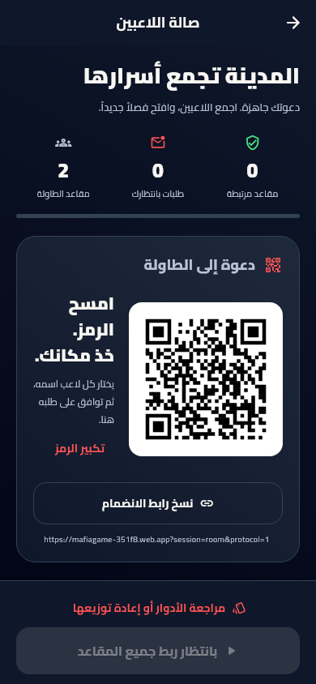
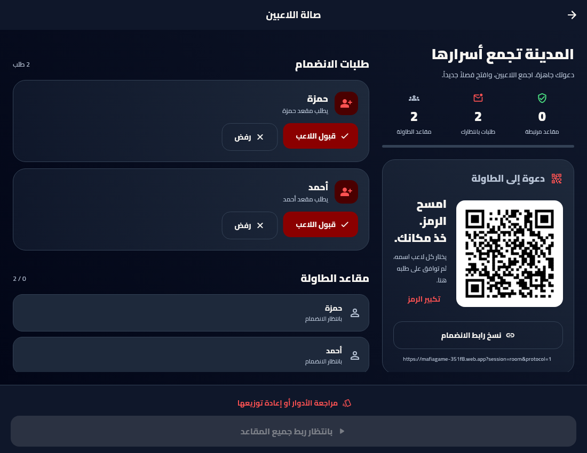

# إصدار 1.2.7 — صالة اللاعبين وربط أسرع

تاريخ التسليم: 2026-10-16. إصدار التطبيق `1.2.7+14`، ورقم Android لنسخة ARM64 هو `2014`.

## صالة الانتظار

أعيد تصميم الصالة عند الحكم باستخدام هوية الأحمر الدموي: عنوان واضح، عدادات المقاعد والطلبات، مؤشر اكتمال الربط، بطاقة دعوة، قائمة طلبات مباشرة، ومقاعد بحالات واضحة. الهاتف يستخدم مسار تمرير واحداً، والشاشة الأعرض تفصل بطاقة الدعوة عن إدارة الطلبات. يمكن الضغط على عداد الطلبات للانتقال إليها.

- زر **نسخ رابط الانضمام** ينسخ الرابط الكامل نفسه المضمّن في QR، بما فيه معرّف الجلسة ورقم البروتوكول. يظهر تأكيد النسخ، ويمكن تحديد الرابط يدوياً إذا تعذرت الحافظة.
- يمكن تكبير QR داخل نافذة قابلة للتمرير. يحتفظ الرمز بخلفية بيضاء وتباين واضح، ويُعاد استخدام رسمه عند تحديث العدادات والطلبات.
- تظهر أزرار القبول والرفض مباشرة، دون فتح بطاقة مطوية أولاً. لكل طلب حالة تنفيذ مستقلة، وتُمنع الأوامر المتضاربة للمقعد نفسه مع استمرار معالجة المقاعد الأخرى.
- لا تختفي الطلبات عند فشل التنفيذ، ويظل خيار إعادة المحاولة متاحاً. نجاح العملية لا يُعرض قبل اكتمال تأكيدها؛ وتبقى بداية اللعبة معطلة حتى تُظهر بيانات المقاعد اكتمال الربط فعلياً.
- حالة «تم ربط المقعد» تعني ربط الهوية بالمقعد، ولا تدّعي قياس حضور الجهاز أو اتصاله اللحظي.

## تقليل الانتظار

المزامنة تعتمد على مستمعي Firestore المباشرين، دون استطلاع دوري. أزيلت أسباب انتظار إضافية داخل التطبيق:

| المسار | التغيير |
| --- | --- |
| إنشاء غرفة جديدة | قراءة واحدة للتحقق من وجود الغرفة بدلاً من قراءة تحقق وقراءة إضافية بعدها؛ الغرفة الموجودة تُقرأ ويُحافظ على بياناتها. |
| الموافقة على طلب | تبدأ قراءات الغرفة والمقعد والطلب والعضوية الأربع معاً داخل المعاملة بدلاً من انتظار كل قراءة قبل التالية. |
| تكرار الضغط | تُجمّع الموافقات المتطابقة في عملية جارية واحدة؛ اختبار عشر محاولات متزامنة أثبت تنفيذ معاملة واحدة. |
| مقاعد مختلفة | يمكن قبول طلباتها بالتوازي، مع بقاء حماية المعاملة من ربط مقعد أو هوية مرتين. |
| دخول اللاعب بعد الموافقة | يستمع اللاعب إلى وثيقة عضويته الخاصة مباشرة؛ ينتقل عند تأكيدها حتى إذا تأخر تحديث قائمة المقاعد. يُطلب إطار عرض لتنفيذ الانتقال فور وصول الإشارة بين الإطارات. |
| تعارض اختيار المقعد | يستطيع اللاعب استبدال طلبه بمقعد آخر متاح بهويته نفسها، مع إعادة التحقق من الطلب داخل معاملة الحكم. |

تبقى فحوص الملكية والجلسة المنتهية والمقعد المشغول والطلب المتغير داخل المعاملة. لا يوجد قبول آلي لكل الطلبات، ولا تبدأ المباراة قبل اكتمال الربط. لم تتغير قواعد الفوز أو حسم اللعب.

هذه تحسينات لمسارات الانتظار والعمل داخل التطبيق، وليست قياساً أو ضماناً لزمن اتصال حقيقي بين هاتفين؛ يعتمد ذلك أيضاً على الشبكة وموقع قاعدة البيانات. لا تفعّل هذه النسخة خدمات مدفوعة أو خادم V2.

## التحقق

- نجح **149 اختبار Flutter**، بينها **13 اختباراً جديداً** للخدمة والصالة ودخول اللاعب.
- تشمل اختبارات الخدمة بدء القراءات الأربع دون انتظار متسلسل، منع الموافقات المكررة، القبول المتزامن لمقعدين مختلفين، فشل الحفظ وإعادته، منع قبول طلب قديم أو مقعد مشغول، واختصار إنشاء الغرفة مع الحفاظ على الغرف الموجودة.
- تشمل اختبارات الواجهة نسخ الرابط، تحديث الطلبات مباشرة، حالات التنفيذ المستقلة، منع البدء ببيانات مقاعد متأخرة، أخطاء الاتصال وإعادة المزامنة، شاشة 320 بكسل بنص مكبّر، تكبير QR، العرض الواسع، ودخول اللاعب من إشارة العضوية قبل تحديث القائمة.
- التحليل الساكن بلا مشاكل. تُفحص صلاحيات العضوية الخاصة وتعارضات الموافقة باستخدام Firestore المحلي ومحرك Dart الفعلي.
- المراجعة البصرية من صور Flutter الفعلية، دون متصفح أو محاكي Android. اختبار السلاسة بين هاتف الحكم وهواتف اللاعبين يبقى تجربة أجهزة فعلية بعد التحديث.

