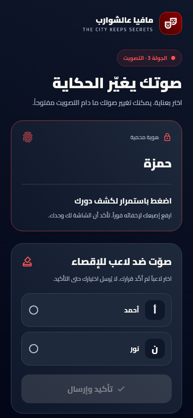
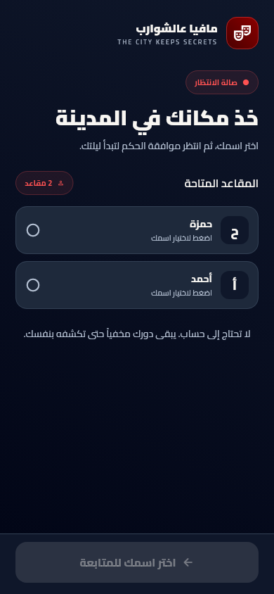

# إصدار 1.2.6 — هوية الأحمر الدموي وواجهات لاعبي QR

تاريخ التسليم: 2026-10-16. إصدار التطبيق `1.2.6+13`، ورقم Android لنسخة ARM64 هو `2013`.

## اتساق الثيم

ظلّت لوحة الأحمر الدموي الأصلية بخلفيتها الليلية وتدرجها `#8B0000 → #4A0000`. عُرّفت ألوان حاويات Material والأسطح والنوافذ والحقول ومكوّنات الاختيار صراحة، بدلاً من درجات Material الوردية المولّدة تلقائياً. استُبدل اللون الوردي القديم للمافيا بأحمر واضح، وأصبحت أزرار التأكيد والخروج والتسجيل الداكنة بنصوص فاتحة مقروءة.

تشمل المراجعة التسجيل، استعادة كلمة المرور، التحقق من البريد، تأكيد إنهاء المباراة، تأكيد إنهاء غرفة QR، أدوات الحكم، الملف الشخصي وبطاقة تسليم الدور وإطار التقرير، أزرار الإعداد والتصويت والليل، وبقية المكوّنات المشتركة. تبقى ألوان الفرق والنجاح والتنبيه ذات دلالة مستقلة، وتبقى الجريدة بتصميم الورق المخصص لها. الثيمات الأخرى تستخدم لوحة كل ثيم عند اختياره.

## واجهات اللاعبين

أعيد تصميم الانضمام واختيار المقعد وانتظار الموافقة واللعب ونهاية الجلسة بمكوّنات مشتركة: هوية اللعبة، حالة الجولة، بطاقة خاصة، بطاقات الإجراء، واختيارات واضحة. تستخدم الواجهة العربية مسار تمرير واحداً وتتكيف مع الهاتف والشاشات الأعرض والنص المكبّر. يبقى طلب الانضمام خاضعاً لموافقة الحكم.

تظهر بطاقة الدور عند استمرار الضغط وتُخفى فور رفع الإصبع أو إلغاء الضغط أو انتقال التطبيق للخلفية، دون انتقال بصري يحتفظ بالنص السري. يدعم التركيز على البطاقة الكشف المؤقت بلوحة المفاتيح. أسماء زملاء المافيا وقدرة القنص تبقى داخل البطاقة السرية. نتيجة التحقيق الخاصة قابلة للإخفاء وإعادة العرض، وتُخفى تلقائياً بعد عرضها الأول.

تعرض لوحة التصويت اختيارك وتتيح تغييره حتى إغلاق التصويت، وترسل نسخة الإجراء والمراجعة كما يتطلب البروتوكول. تُعطّل الإرسال عند إغلاق النافذة أو اختلاف مراجعة الإجراء، وتسمح بإعادة المحاولة عند فشل الإرسال. لا يُعاد اختيار تصويت من جولة سابقة. تخطي قنص QR له زر واضح ويحافظ على عقد اختيار النفس كإشارة تخطٍ، دون تعديل محرك القنص.

أصبحت شاشة تحميل الويب واسم الصفحة وأيقوناتها تحمل هوية اللعبة أيضاً. تُحذف شاشة التحميل بعد تشغيل Flutter، وتعرض إعادة المحاولة عند فشل التهيئة. لم تُعدّل قواعد الفوز أو حسم الليل والتصويت أو صلاحيات Firestore في هذا الإصدار.

## التحقق والتسليم

- نجح **136 اختبار Flutter**، بينها 14 اختباراً جديداً للثيمات وواجهات اللاعبين والتسجيل، مع فحوص اللعبة السابقة للمؤقت والتعادل وحسم الليل.
- تشمل فحوص QR طلب المقعد وانتظار الموافقة، خصوصية البطاقة والرجوع من الخلفية، تعديل التصويت برقم النسخة الصحيح، إغلاق التصويت، فشل الإرسال وإعادته، تخطي القنص، الموت ونهاية الجلسة، وشاشة 320 بكسل مع تكبير النص وشاشة سطح مكتب.
- التحليل الساكن بلا مشاكل، وبناء Web release ناجح. فُحص JavaScript المولّد نحوياً، ونجحت أربعة فحوص لبدء الويب وحالات فشل التحميل والتهيئة والتشغيل باستخدام Node فقط.
- صور المراجعة مولّدة من عناصر Flutter الفعلية، دون متصفح أو محاكي Android. لا يمثل ذلك اختباراً على متصفح أو هاتف فعلي.
- نُشرت واجهة الويب على Firebase Hosting، وتُفحص مطابقة ملفاتها العامة للنسخة المبنية. خادم V2 والخدمات المدفوعة ما زالت معطلة افتراضياً.
- APK release بنفس شهادة توقيع الإصدار السابق. تُفحص تجربة الهاتف الفعلية بعد التنزيل.

